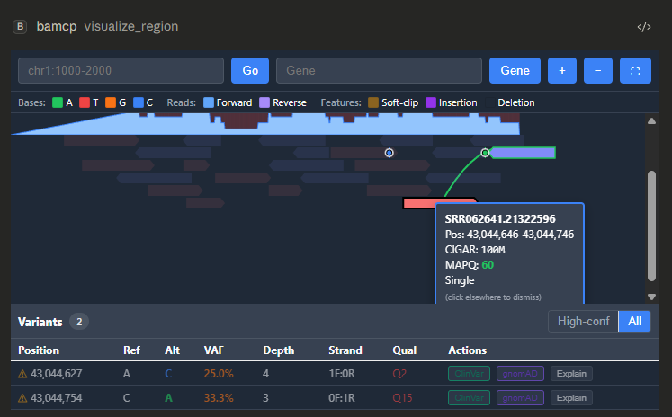

# BAMCP

**Interactive BAM/CRAM variant visualization for AI assistants via the Model Context Protocol**

[](https://github.com/RTrentJones/BAMCP/actions/workflows/ci.yml)
[](https://github.com/RTrentJones/BAMCP/actions/workflows/security.yml)
[](https://tracer.rtrentjones.dev/projects/bamcp)
[](https://modelcontextprotocol.io)
[](https://python.org)
[](LICENSE)

BAMCP brings IGV-style alignment visualization directly into your AI conversations. Browse BAM/CRAM files, inspect variant evidence, and navigate genomic regions—all through natural language interaction with Claude or other MCP-enabled assistants.

<p align="center">
  
</p>

---

## Try this in 2 minutes

No install, no data of your own. The hosted demo server is **`https://bamcp.rtrentjones.dev/mcp`**.

1. In claude.ai, open **Settings → Connectors → Add custom connector**, paste
   `https://bamcp.rtrentjones.dev/mcp`, and connect (sign-in is automatic — it is an open demo).
2. In a new chat, enable the BAMCP connector and paste any of these:

   ```text
   Use BAMCP on demo:HG002. Call list_contigs first, then show me the reads at
   chr17:43099864-43099964 and tell me whether the variant at chr17:43099914 looks real.
   ```

   ```text
   On demo:HG002, compare chr17:43099914 G>A with chr17:43096151 T>G using
   get_variant_curation_summary. Which one looks like a sequencing artifact, and why?
   Explain it like I'm new to genomics.
   ```

   ```text
   Look up chr17:43099914 G>A in ClinVar and gnomAD (build GRCh38). How common is it,
   and what can and can't I conclude from that?
   ```

   ```text
   Use the explore_demo prompt on demo:HG00096 (a GRCh37 sample whose contigs are named
   "13", not "chr13") and walk me through the BRCA2 locus.
   ```

**What you'll see:** an interactive pileup of real reads from the public
[Genome in a Bottle](https://www.nist.gov/programs-projects/genome-bottle) sample HG002
(about 60 reads deep), a clean heterozygous SNV where roughly half of ~57 reads carry the
alternative base, an artifact a few kb away (chr17:43096151 T>G: 11 of ~50
reads, all on the forward strand, mean base quality ~Q8 — the default filters hide it from
`get_variants`, and `get_variant_curation_summary` still scores it HIGH artifact risk and says
which filters it fails), and ClinVar/gnomAD context showing both curated SNVs are common,
benign polymorphisms.

**Demo aliases** (usable as `file_path` in every tool that takes one): `demo:HG002` (GIAB HG002, GRCh38,
`chr17`-style) and `demo:HG00096` (1000 Genomes, GRCh37, `17`-style). The curated loci live in
the `bamcp://demos` resource; the server also ships `explore_demo`, `check_variant`, and
`explain_terms` prompts.

**Your own files:** the hosted server only fetches public, indexed BAM/CRAM files from an
allow-list of genomics hosts — `ftp-trace.ncbi.nlm.nih.gov`, `ftp.ncbi.nlm.nih.gov`,
`ftp.1000genomes.ebi.ac.uk`, `1000genomes.s3.amazonaws.com`, `ftp.ensembl.org`,
`hgdownload.soe.ucsc.edu`. For anything else (or private data), run BAMCP locally
([Installation](#installation)). Running it yourself, remote files are off by default: set
`BAMCP_ALLOW_REMOTE_FILES=true` (and `BAMCP_ALLOWED_REMOTE_HOSTS`) to use the `demo:` aliases or
any URL.

**Default filters** for candidate variants:
`min_mapq 20`, `min_baseq 13`, `min_vaf 0.10`, `min_depth 2`, `min_alt_count 3` — every variant
response echoes the thresholds it applied in `applied_filters`, so a missing variant may simply
have been filtered out.

**Interpreting results:** read the `bamcp://glossary` resource (VAF, depth, MAPQ, strand bias,
artifact risk, ClinVar stars, gnomAD reliability…), each with what you *can* and *cannot*
conclude. BAMCP is a research and education tool, **not** a diagnostic test — see
[SAFETY.md](SAFETY.md).

---

## Table of Contents

- [Try this in 2 minutes](#try-this-in-2-minutes)
- [Why BAMCP?](#why-bamcp)
- [Features](#features)
- [Architecture](#architecture)
- [Installation](#installation)
- [Usage](#usage)
- [Tools Reference](#tools-reference)
- [Configuration](#configuration)
- [Implementation Details](#implementation-details)
- [Evaluation](#evaluation)
- [Development](#development)
- [Roadmap](#roadmap)
- [Related Projects](#related-projects)
- [Contributing](#contributing)
- [Security & Safety](#security--safety)
- [License](#license)
- [Acknowledgments](#acknowledgments)

---

## Why BAMCP?

Existing genomics MCP servers (bio-mcp-samtools, AWS HealthOmics MCP) provide command-line operations but return text/JSON. **BAMCP uses the [MCP Apps Extension](https://github.com/modelcontextprotocol/ext-apps) to render interactive visualizations inline.**

| Feature | CLI-based MCPs | BAMCP |
|---------|---------------|-------|
| Read BAM/CRAM files | ✅ | ✅ |
| Coverage statistics | ✅ | ✅ |
| **Interactive visualization** | ❌ | ✅ |
| **Variant browsing UI** | ❌ | ✅ |
| **Pan/zoom navigation** | ❌ | ✅ |
| **Inline in chat** | ❌ | ✅ |

---

## Features

- **Alignment Viewer** — Visualize reads with color-coded mismatches, insertions, deletions, and soft clips
- **Coverage Track** — Real-time depth of coverage across the viewing window
- **Variant Highlighting** — Automatic detection and highlighting of positions with non-reference alleles
- **VCF/BCF Overlay** — Use caller-produced variants as a primary/overlay source, including sample genotypes and structural-variant metadata
- **Region Navigation** — Jump to coordinates, genes, or specific variants
- **Format Support** — BAM, CRAM (with reference), and indexed remote files over HTTP/HTTPS (including public S3 buckets via their HTTPS URLs)
- **Canvas Rendering** — High-performance visualization of thousands of reads via HTML5 Canvas
- **Multiple Transports** — stdio, Streamable HTTP (preferred for network), and legacy SSE
- **OAuth 2.0 Authentication** — Optional token-based auth for network deployments
- **Docker Ready** — Production and development Docker images with compose profiles

---

## Architecture

```
┌─────────────────────────────────────────────────────────────────────────────┐
│                        MCP Client (Claude, Cursor, etc.)                    │
└─────────────────────────────────┬───────────────────────────────────────────┘
                                  │
                                  │ MCP Protocol (JSON-RPC over stdio/SSE/HTTP)
                                  ▼
┌─────────────────────────────────────────────────────────────────────────────┐
│                       BAMCP MCP Server (Python + FastMCP)                    │
│                                                                             │
│  ┌─────────────────┐  ┌─────────────────┐  ┌─────────────────────────────┐  │
│  │                 │  │                 │  │                             │  │
│  │  pysam Layer    │  │  Tool Handlers  │  │  UI Resource Provider       │  │
│  │                 │  │                 │  │                             │  │
│  │  • AlignmentFile│  │  • 13 tools:    │  │  • ui://bamcp/viewer        │  │
│  │  • fetch()      │  │  • get_variants │  │  • text/html;profile=mcp-app│  │
│  │  • pileup()     │  │  • visualize_…  │  │  • Sandboxed iframe content │  │
│  │  • CRAM support │  │  • lookup_*     │  │                             │  │
│  │                 │  │  • +9 more      │  │                             │  │
│  └─────────────────┘  └─────────────────┘  └─────────────────────────────┘  │
│                                                                             │
│  ┌─────────────────┐  ┌─────────────────────────────────────────────────┐  │
│  │  Auth (opt-in)  │  │  Config (env vars)                              │  │
│  │  • OAuth 2.0 AS │  │  • Transport, host, port                        │  │
│  │  • Token mgmt   │  │  • Reference path, read limits                  │  │
│  │  • Client reg   │  │  • Auth settings                                │  │
│  └─────────────────┘  └─────────────────────────────────────────────────┘  │
└─────────────────────────────────────────────────────────────────────────────┘
```

### Data Flow

```
User: "Show me reads at chr17:7577000-7577500 in tumor.bam"
                              │
                              ▼
                    ┌─────────────────┐
                    │  MCP Client     │
                    │  (Claude)       │
                    └────────┬────────┘
                             │ tools/call: visualize_region
                             ▼
                    ┌─────────────────┐
                    │  BAMCP Server   │
                    │                 │
                    │  1. Parse region│
                    │  2. pysam.fetch │
                    │  3. Serialize   │
                    │  4. Return UI   │
                    └────────┬────────┘
                             │ CallToolResult with ui/resourceUri
                             ▼
                    ┌─────────────────┐
                    │  MCP Client     │
                    │  renders iframe │
                    └────────┬────────┘
                             │ postMessage: init with read data
                             ▼
                    ┌─────────────────┐
                    │  Canvas UI      │
                    │                 │
                    │  1. Parse reads │
                    │  2. Pack rows   │
                    │  3. Render      │
                    └─────────────────┘
```

---

## Installation

### Prerequisites

- Python 3.10+
- [pysam](https://pysam.readthedocs.io/) (requires htslib)
- Node.js + npm (to build the viewer bundle)

### From PyPI (coming soon)

```bash
pip install bamcp
```

### From Source

```bash
git clone https://github.com/RTrentJones/BAMCP.git
cd BAMCP
python -m venv venv
source venv/bin/activate  # or `venv\Scripts\activate` on Windows
make install              # builds the viewer (npm), then pip install -e ".[dev]"
```

### Docker

```bash
# Build production image
docker compose --profile prod build

# Run production server (Streamable HTTP on port 8000). The prod profile enables auth, so it
# needs a service token — the server refuses to start without one:
BAMCP_VERIFY_TOKEN="$(openssl rand -hex 32)" docker compose --profile prod up

# Prefer to run without auth? Use the preview profile (Streamable HTTP at /mcp, auth disabled):
docker compose --profile preview up
# (the beta profile is also auth-free, but serves legacy SSE at /sse)

# Run tests in Docker
docker compose --profile dev run --rm test
```

### MCP Client Configuration

#### Claude Desktop (stdio)

Add to your Claude Desktop config file (`claude_desktop_config.json`):

```json
{
  "mcpServers": {
    "bamcp": {
      "command": "python",
      "args": ["-m", "bamcp"],
      "env": {
        "BAMCP_REFERENCE": "/path/to/hg38.fa"
      }
    }
  }
}
```

#### Streamable HTTP (network, preferred)

Run the server with `BAMCP_TRANSPORT=streamable-http` and point an MCP client that supports
Streamable HTTP at `http://localhost:8000/mcp`.

> Legacy SSE (`BAMCP_TRANSPORT=sse`, URL `http://localhost:8000/sse`) is still supported for
> compatibility, but the MCP spec deprecates the HTTP+SSE transport in favor of Streamable HTTP.
> Prod runs Streamable HTTP.

#### Cursor / VS Code

> **Note:** `uvx bamcp` requires the PyPI release, which is not yet published. Until
> then, run from a local checkout — `"command": "uv"`, `"args": ["run", "bamcp"]` with
> `"cwd"` set to your clone — or use the stdio `python -m bamcp` form above.

```json
{
  "mcpServers": {
    "bamcp": {
      "command": "uvx",
      "args": ["bamcp"]
    }
  }
}
```

---

## Usage

### Browse a Region

> "Show me the reads at chr17:7577000-7577500 in /data/tumor.bam"

The assistant will call `visualize_region` and render an interactive alignment viewer inline.

### Jump to a Position

> "Jump to position 7674220 on chr17 in my BAM"

Centers the viewer on a specific position with a configurable window size.

### Inspect a Variant

> "What's the evidence for the variant at chr7:140453136 in my sample?"

BAMCP will center on the position and highlight reads supporting reference vs. alternate alleles.

### Get Coverage Stats

> "What's the average coverage across TP53 in my exome?"

Returns coverage statistics without visualization.

### List Available Chromosomes

> "What contigs are in this BAM file?"

---

## Tools Reference

All 13 tools are registered in [`src/bamcp/server.py`](src/bamcp/server.py); descriptions
below are condensed from each tool's registered description.

| Tool | Description | Required Args | Optional Args |
|------|-------------|---------------|---------------|
| `visualize_region` | Visualize aligned reads in a genomic region with the interactive MCP Apps viewer | `file_path`, `region` | `reference`, `vcf_path`, `variant_source` |
| `get_variants` | Detect and return candidate variants in a region; each carries `artifact_risk`, confidence, concerns and a plain-language interpretation (with a zygosity hint) | `file_path`, `region` | `reference`, `vcf_path`, `variant_source`, `min_vaf`, `min_depth`, `min_alt_count` |
| `get_coverage` | Calculate depth of coverage statistics for a region | `file_path`, `region` | `reference` |
| `list_contigs` | Detect the genome build (GRCh37 vs GRCh38) and contig naming style and list primary chromosomes; use this first on new BAM files | `file_path` | `reference`, `include_all` |
| `jump_to` | Jump to a specific genomic position (1-based) and view surrounding reads | `file_path`, `contig`, `position` | `window`, `reference`, `vcf_path`, `variant_source` |
| `get_region_summary` | Text summary of a region (read count, coverage, candidate variants with interpretations) for LLM reasoning | `file_path`, `region` | `reference`, `vcf_path`, `variant_source`, `min_alt_count` |
| `scan_variants` | Scan a contig or region for candidate SNVs (fast, coverage-based; needs a reference); returns up to 500 candidates sorted by position, and `next_region` when the time budget truncates the scan | `file_path` | `contig`, `region`, `reference`, `min_vaf`, `min_depth`, `min_alt_count` |
| `lookup_clinvar` | Look up a variant in ClinVar for clinical significance, review status and associated conditions (1-based, in `build`) | `chrom`, `pos`, `ref`, `alt` | `build` |
| `lookup_gnomad` | Look up a variant in gnomAD for population allele frequency (GRCh37 queries gnomAD v2.1, GRCh38 queries v4) | `chrom`, `pos`, `ref`, `alt` | `build` |
| `get_variant_curation_summary` | Detailed curation summary with artifact risk, quality metrics and recommendations; evaluates the named site even when it fails the calling filters (`filter_check`) | `file_path`, `chrom`, `pos`, `ref`, `alt` | `window`, `reference`, `format` (`text`/`rubric`; `json` = `rubric`), `include_clinical` |
| `classify_variant` | Assemble BAM + ClinVar + gnomAD evidence and return an ACMG reasoning scaffold (research-grade, not a clinical determination) | `file_path`, `chrom`, `pos`, `ref`, `alt` | `gene`, `window`, `reference` |
| `search_gene` | Search for a gene by symbol and return 1-based coordinates; pass `file_path` so the build is auto-detected | `symbol` | `file_path`, `build` |
| `cleanup_cache` | Clear the server's downloaded BAM index files and region cache (single-client stdio servers only; shared HTTP servers expire their cache by TTL) | — | — |

> **Genome build & `search_gene`.** Gene coordinates are build-specific — a GRCh38 locus in a
> GRCh37 BAM is silently ~0.5–2 Mb off the real gene. Pass the BAM's **`file_path`** to
> `search_gene` and it auto-detects the build from the header and returns matching coordinates
> (or set **`build`** to override). The response states the coordinates' `genome_build` and warns
> on any mismatch. Without a `file_path`, coordinates use the server default (`BAMCP_GENOME_BUILD`,
> default GRCh38) — confirm your BAM's build with `list_contigs` first.

#### VCF as the primary variant source

BAMCP is at its best as an **evidence viewer** for a trusted caller's variants rather than
an ad-hoc caller of its own. Pass `vcf_path` (VCF/BCF) plus `variant_source` to control the
relationship:

- **`variant_source="vcf"`** — the VCF is the authoritative variant set. BAMCP does *not* add
  its own candidates; it reads the BAM and attaches read-level evidence (strand balance, mean
  quality, artifact risk, confidence) to each VCF site so you can review support. Requires `vcf_path`.
- **`variant_source="auto"`** (default) — BAMCP's read-level candidates with the VCF overlaid and
  de-duplicated.
- **`variant_source="bamcp"`** — BAMCP's read-level candidates only; any `vcf_path` is ignored.

The VCF must be bgzip-compressed and indexed (`.tbi`/`.csi`), or an indexed BCF.

Enrich further with `lookup_clinvar` / `lookup_gnomad` on the returned 1-based positions.

#### Error vs. absence in database lookups

`lookup_clinvar` / `lookup_gnomad` responses carry an explicit `status`:
`found` · `not_found` (the variant is genuinely absent from that database) ·
`unavailable` (the lookup **errored or timed out** — absence is *unknown*) · `disabled`
(switched off on this server via `BAMCP_CLINVAR_ENABLED` / `BAMCP_GNOMAD_ENABLED`). Invalid
input (a bad allele, position or build) is a tool error (`isError`), not a status. This matters because a failed lookup must not read as "not in the database" —
in the ACMG scaffold (`classify_variant`) that would let a network blip masquerade as rarity
(PM2) or "no pathogenic assertion" evidence. When a source is `unavailable` (or `disabled`), the
fused evidence block is `{"status": "unavailable"}` / `{"status": "disabled"}` (not `null`) and
the scaffold marks that evidence line as not established rather than treating it as absence.

#### Self-describing filters

Every variant-producing response (`get_variants`, `visualize_region`, `jump_to`,
`scan_variants`, `get_variant_curation_summary`, `classify_variant`; `get_region_summary` as a
"Filters applied" line) echoes what it **actually applied** — `applied_filters` (`min_vaf`,
`min_depth`, `min_mapq`, `min_baseq`, `min_alt_count`, `excluded_reads`, `overlapping_mates`,
`reference_source`, `max_reads` / `reads_truncated` where reads are shown, and whether SNV and
indel detection ran) plus a `filter_note`. This makes a variant's **absence** interpretable: an empty result
at a site may reflect an aggressive `min_vaf`/`min_depth` rather than a true reference call. Loosen
the thresholds (per-call `min_vaf`/`min_depth`, or the server defaults) to widen the net.

### Demo datasets, resources & prompts

Any `file_path` argument also accepts a demo alias — `demo:HG002` (GIAB HG002, GRCh38, chr-style)
or `demo:HG00096` (1000 Genomes, GRCh37, no `chr`). The alias is swapped for the dataset's public
URL before validation, so the normal remote-URL checks still apply (`BAMCP_ALLOW_REMOTE_FILES=true`,
and the dataset's host on any allow-list); an unknown `demo:` name is an error that lists the
available demos. No tools are added for this — discovery is via MCP:

| Kind | Name | What it is |
|------|------|-----------|
| Resource | `ui://bamcp/viewer` | The MCP Apps alignment viewer (HTML) used by `visualize_region` / `jump_to` |
| Resource | `bamcp://demos` | Demo datasets (JSON): alias, URL, build, contig style, matching reference URL, curated 1-based loci |
| Resource | `bamcp://glossary` | Plain-language glossary with "can / cannot conclude" for each term |
| Resource | `bamcp://guide` | Four-step newcomer guide |
| Prompt | `explore_demo(dataset)` | Guided tour: real het SNV vs. artifact cluster, ClinVar/gnomAD context |
| Prompt | `check_variant(file_path, region)` | Check the read evidence at a position or region |
| Prompt | `explain_terms(terms)` | Explain output terms (comma-separated, or all) |

### Region Format

Regions are **1-based, inclusive** (samtools-style):
- `chr1:1000-2000` — Standard format (1,001 bases)
- `chr1:1,000-2,000` — Commas allowed
- `chr1:1000` — A single base (same as `chr1:1000-1000`)
- `1:1000-2000` — Without "chr" prefix (must match the BAM header; `list_contigs` shows the style)

A region string is at most 100 characters and spans at most 1 Mbp.

---

## Configuration

### Core Settings

| Environment Variable | Description | Default |
|---------------------|-------------|---------|
| `BAMCP_REFERENCE` | Default reference FASTA (needed to decode CRAM and for SNV/indel detection) | None |
| `BAMCP_MAX_READS` | Maximum reads returned for display per region (coverage and variant counts are not capped) | `10000` |
| `BAMCP_DEFAULT_WINDOW` | Default `jump_to` window size (bp) | `500` |
| `BAMCP_MIN_VAF` | Minimum allele fraction for candidate variants | `0.10` |
| `BAMCP_MIN_DEPTH` | Minimum depth for candidate variants | `2` |
| `BAMCP_MIN_ALT_COUNT` | Minimum reads supporting the alternative allele | `3` |
| `BAMCP_MIN_MAPQ` | Minimum mapping quality filter | `20` |
| `BAMCP_MIN_BASEQ` | Minimum base quality for coverage and candidate variant counts | `13` |
| `BAMCP_NCBI_API_KEY` | Optional NCBI E-utilities API key (10 req/s instead of 3); ClinVar/gene lookups retry NCBI 429s with bounded backoff either way | None |
| `BAMCP_MAX_REMOTE_INDEX_BYTES` | Maximum remote BAM/CRAM index download size | `67108864` |
| `BAMCP_GENOME_BUILD` | Default build for lookups and `search_gene` without a BAM (`GRCh37`/`hg19`/`b37` or `GRCh38`/`hg38`) | `GRCh38` |
| `BAMCP_CLINVAR_ENABLED` | Enable ClinVar lookups (off → `status: disabled`) | `true` |
| `BAMCP_GNOMAD_ENABLED` | Enable gnomAD lookups (off → `status: disabled`) | `true` |
| `BAMCP_GNOMAD_DATASET` | gnomAD dataset; `auto` picks by build, an explicit dataset must match the lookup's build | `auto` |
| `BAMCP_CACHE_DIR` | Directory for downloaded index files (falls back to a temp dir if the default is not writable) | `~/.cache/bamcp` |
| `BAMCP_CACHE_TTL` | Index and region cache lifetime (seconds) | `86400` |
| `BAMCP_MAX_INDEX_CACHE_BYTES` | Total size cap for the on-disk index cache | `536870912` |
| `BAMCP_PREWARM` | Warm the demo datasets in the background at startup (HTTP transports only) | `true` |

### Transport Settings

| Environment Variable | Description | Default |
|---------------------|-------------|---------|
| `BAMCP_TRANSPORT` | Transport mode: `stdio`, `sse`, `streamable-http` | `stdio` |
| `BAMCP_HOST` | HTTP bind address | `0.0.0.0` |
| `BAMCP_PORT` | HTTP port | `8000` |

### Authentication Settings

| Environment Variable | Description | Default |
|---------------------|-------------|---------|
| `BAMCP_AUTH_ENABLED` | Enable auth (`true`/`false`) | `false` |
| `BAMCP_ISSUER_URL` | OAuth issuer URL | `http://localhost:8000` |
| `BAMCP_RESOURCE_SERVER_URL` | OAuth resource server URL | `http://localhost:8000` |
| `BAMCP_REQUIRED_SCOPES` | Comma-separated required scopes (defaults to `bamcp:read` when auth is on) | None |
| `BAMCP_TOKEN_EXPIRY` | Access token lifetime (seconds) | `3600` |
| `BAMCP_ALLOW_DYNAMIC_REGISTRATION` | Allow OAuth dynamic client registration | `false` |
| `BAMCP_VERIFY_TOKEN` | M2M service token (a single bearer accepted statelessly) | None |

### Telemetry Settings

| Environment Variable | Description | Default |
|---------------------|-------------|---------|
| `BAMCP_TELEMETRY_ENABLED` | Enable tool-call telemetry | `false` |
| `BAMCP_TELEMETRY_PATH` | JSONL output file (empty disables file output) | None |
| `BAMCP_TELEMETRY_OTEL` | Export via OpenTelemetry (needs the `[telemetry]` extra) | `false` |

**Trust model.** BAMCP is a single-instance server, not a multi-tenant identity provider. Access
is a **service token** (`BAMCP_VERIFY_TOKEN`) — a stateless bearer that survives restarts.
Dynamic client registration is **off by default**: an open `/register` endpoint would let any
client self-register and mint a token, which is not access control. Enable it
(`BAMCP_ALLOW_DYNAMIC_REGISTRATION=true`) only where open sign-up is intended: interactive OAuth
clients in a dev context, or a public demo (the hosted demo enables it so claude.ai connectors
can sign in, and every in-memory OAuth store is size-bounded). With auth enabled, an
unauthenticated request is rejected (401) and only the service token (or, with dynamic
registration on, a registered client's token) is authorized; the server refuses to start with
auth on but neither `BAMCP_VERIFY_TOKEN` nor dynamic registration set. The `/__version`
deploy-identity route is unauthenticated.

### Security Settings

| Environment Variable | Description | Default |
|---------------------|-------------|---------|
| `BAMCP_ALLOW_REMOTE_FILES` | Allow HTTP(S) BAM/CRAM/VCF/reference URLs | `false` |
| `BAMCP_ALLOWED_REMOTE_HOSTS` | Comma-separated host allow-list for remote fetch (the real SSRF control) | None |
| `BAMCP_ALLOWED_DIRECTORIES` | Comma-separated local dirs that file paths must be under | None |
| `BAMCP_RATE_LIMIT` | Requests per minute per client IP (every MCP JSON-RPC message counts) | `120` |
| `BAMCP_RATE_LIMIT_TRUSTED_PROXIES` | IPs/CIDRs whose `CF-Connecting-IP` / `X-Forwarded-For` headers are trusted | loopback (`127.0.0.1`, `::1`) |
| `BAMCP_TRUSTED_HOSTS` | Comma-separated allowed `Host` headers (DNS-rebinding protection) | None (no Host check) |

Remote fetch is SSRF-guarded: private/internal/metadata IPs are always blocked, and — because the
actual fetch is performed by pysam/htslib (which follows redirects outside BAMCP) — the
**host allow-list is the primary control**. Set `BAMCP_ALLOWED_REMOTE_HOSTS` in any
internet-reachable deployment. Client-IP headers are honored only from a trusted proxy
(`CF-Connecting-IP` first, then `X-Forwarded-For` walked right-to-left), so a client cannot spoof
its IP to bypass rate limits.

---

## Implementation Details

### Canvas Rendering

Genomic regions often contain thousands of reads, which is costly to render as individual DOM or
SVG elements. BAMCP draws reads, coverage and the reference on a Canvas 2D surface; the viewer is
a TypeScript app bundled by Vite (`src/bamcp/static/`).

### Read Packing Algorithm

Reads are packed into rows using a greedy algorithm:

```
For each read (in the chosen sort order — position, MAPQ, insert size or strand — with mates kept together):
    If the row that ends earliest ends before read.start: add the read to that row
    Else: create new row
```

A min-heap of row end positions keeps this O(n log rows) while preventing overlaps.

### Variant Detection

BAMCP performs simple pileup-based candidate detection (it needs a reference):

1. Count A/C/G/T at each position from reads passing `min_mapq` (unmapped, secondary,
   supplementary, duplicate and QC-fail reads excluded), counting only bases at or above `min_baseq`
2. Calculate VAF = alt_count / depth, where depth includes reads carrying a deletion at the position
3. Report SNVs where VAF ≥ `min_vaf`, depth ≥ `min_depth` and alt reads ≥ `min_alt_count`
4. Detect indels with a separate pileup pass for regions up to 100 kb (`scan_variants` is SNV-only)

This is intentionally basic—for production variant calling, use dedicated tools (GATK, DeepVariant, etc.).

### CRAM Support

CRAM files require a reference FASTA for decoding. Set `BAMCP_REFERENCE` or pass `reference` to each tool call. With `BAMCP_ALLOW_REMOTE_FILES=true` and neither set, BAMCP auto-selects a public reference matching the file's detected build and contig naming (`applied_filters.reference_source: auto`).

---

## Evaluation

BAMCP is evaluated three ways; each result below links to the document it comes from.
Methodology for the harnesses is in [EVALS.md](EVALS.md).

### CI gate: deterministic ground truth

The `eval-smoke` job in [`.github/workflows/ci.yml`](.github/workflows/ci.yml) generates the
test fixtures and runs `make eval-smoke`, which scores BAMCP's own tools with
`bamcp.eval.truthset` against two planted truth sets. It needs no LLM, API key or network, and a
missed floor exits non-zero, which fails the job; the same `make eval-smoke` is the ship-gate in
`greenlight-build.yml`.

- [`synthetic_v1`](tests/eval/datasets/synthetic_v1/manifest.yaml): 9 planted variant alleles
  across 8 sites, 3 reference-only negative regions and 5 artifact sites (strand bias,
  read-position bias, low MAPQ, homopolymer, low depth), scored at the manifest's pinned
  operating point (`min_vaf 0.02`, `min_depth 2`, `min_mapq 0`, `min_baseq 0`,
  `min_alt_count 1`).
- [`indel_v1`](tests/eval/datasets/indel_v1/manifest.yaml): a planted 3 bp deletion and 2 bp
  insertion, scored with `--min-precision 1.0`.

The floors are defined in `TruthsetReport.meets_floors`
([`src/bamcp/eval/truthset.py`](src/bamcp/eval/truthset.py)): variant recall ≥ 1.0, precision ≥
0.95 (1.0 for `indel_v1`), artifact-type recall ≥ 1.0, 0 calls in negative regions, 0 tool
failures, 0 artifact-likelihood mismatches, 0 VAF mismatches (tolerance 0.02 in the manifest),
0 confidence mismatches, the clean control scored below the artifact sites, and 0 sites
reported as both high artifact likelihood and high confidence (the overconfidence guard in
[SAFETY.md](SAFETY.md)). The same job also runs `make eval-visual-dry`, the hermetic self-test
of the visual-study harness.

### GIAB benchmark

[`tests/eval/datasets/giab/GIAB_RESULTS.md`](tests/eval/datasets/giab/GIAB_RESULTS.md) scores
BAMCP's variant detection against NIST Genome-in-a-Bottle truth for HG001 / NA12878 (v4.2.1,
GRCh38) on chr20:1,000,000–1,060,000 (60 kb): 66 truth SNVs (59 hom, 7 het). The reads are
simulated (30×, 100 bp, base-error rate 0.001, seed 1), so this is real variant catalog and
sequence with simulated reads. Point B reproduces with `make giab-benchmark` (network-gated, not
in CI); GIAB_RESULTS.md gives the point-A command.

| Operating point (as named in GIAB_RESULTS.md) | min VAF | min depth | min MAPQ | Recall | Precision | F1 | FP (neg. regions) |
|---|---|---|---|---|---|---|---|
| A — curation sensitivity (pre-2026-10 defaults) | 0.02 | 2 | 0 | 1.000 | 0.034 | 0.066 | 171 |
| B — variant calling | 0.20 | 8 | 20 | 1.000 | 1.000 | 1.000 | 0 |

Per that document: SNVs only (the 7 indel truth records in the slice are skipped), clean
simulated reads make precision at point B an upper bound, and real-read failure modes are not
measured. Its two coordinate corrections (2026-07-26 for variant positions, 2026-10-29 for region
strings) record how the manifest fell out of step when BAMCP moved to 1-based coordinates; the
manifest is now 1-based throughout, and both rows were re-measured on 2026-10-29 and reproduce.
The current server defaults (`min_vaf 0.10`, `min_mapq 20`, `min_baseq 13`, `min_alt_count 3`)
are neither point.

### Visual-vs-text study

The [visual-vs-text study](docs/eval/visual-results.md) asks whether a model reviewing a
candidate variant does better with BAMCP's viewer image, BAMCP's text output, or the reads as
text. Rounds 1, 3, 4 and 5 were pre-registered before their scored runs (round 4 after its
text-only pilots)
([round 1](docs/eval/visual-preregistration.md), [round 3](docs/eval/visual-preregistration-r3.md),
[round 4](docs/eval/visual-preregistration-r4.md), [round 5](docs/eval/visual-preregistration-r5.md)),
and every run was a fresh, blind model from one of three Claude tiers (small/mid/large)
comparing raw read text (later raw `samtools mpileup`), BAMCP's structured JSON (later its text
tools), the viewer image, and image plus text. Both pre-registered primary contrasts in
the pilot were null (adding the picture to raw text: +0.038, CI −0.026 to +0.103, p = 0.375;
the picture alone against the structured JSON: −0.038, CI −0.167 to +0.077, p = 0.61), and none
of round 3's three contrasts was supported. In round 4, on
long-repeat indels, neither BAMCP's text tools nor the viewer raised accuracy, and both cost the
small model true-indel accuracy (0.60 → 0.40 with the text tools, 0.37 with the viewer); after
the resulting spanning-read change, round 5 on 90 fresh sites found BAMCP's text tools raised
balanced accuracy from 0.826 to 0.885 (Holm p = 0.027) and correct genotypes on true indels from
30 to 54 of 135 (Holm p < 0.001). The document's stated limits apply: rounds 1–2 used 26
synthetic items with one run per cell, and the iteration-2 viewer gain (0.821 → 0.910) was
measured on the items that motivated the fix, so it is an upper estimate.

### Model comparison harness

[EVAL_RESULTS.md](EVAL_RESULTS.md) describes the model-comparison and tool-ablation harness; no
real-model results from it are committed.

The eval harnesses and the visual-vs-text study were built by directing Claude Code.

---

## Development

### Project Structure

```
BAMCP/
├── src/
│   └── bamcp/
│       ├── __init__.py
│       ├── __main__.py       # Entry point (transport selection, HTTP middleware)
│       ├── server.py         # FastMCP server setup, tool/resource registration
│       ├── config.py         # Environment-based configuration
│       ├── constants.py      # Shared defaults and thresholds
│       ├── tool_specs.py     # JSON-schema spec per tool
│       ├── resources.py      # UI resource provider
│       ├── demos.py          # demo: dataset aliases
│       ├── prompts.py        # MCP prompts + bamcp://demos / guide resources
│       ├── glossary.py       # bamcp://glossary
│       ├── viewer_build.py   # Viewer source-hash build stamp
│       ├── core/             # tools (handlers), parsers (pysam), validation, serialization,
│       │                     # cache, reference, errors, prewarm
│       ├── analysis/         # evidence, curation, acmg, fusion
│       ├── clients/          # clinvar, gnomad, genes, ncbi, ttl_cache
│       ├── middleware/       # auth (OAuth 2.0), ratelimit, security, telemetry
│       ├── eval/             # evaluation harness (truthset gate, runner, grader, visual/)
│       └── static/           # Viewer TS/Vite app (viewer.html, mcp-app.ts, renderer.ts, …)
│           └── dist/         # Built viewer.html bundle (generated by `make build-viewer`)
├── tests/
│   ├── conftest.py
│   ├── create_fixtures.py    # Generate test BAM/FASTA files
│   ├── create_visual_eval_fixtures.py
│   ├── unit/                 # analysis/, clients/, core/, eval/, middleware/, test_*.py
│   ├── integration/
│   ├── eval/                 # truth-set tests + datasets/ (synthetic_v1, indel_v1, acmg_v1, giab)
│   ├── fixtures/
│   └── e2e/                  # Playwright viewer tests
├── docker/
│   ├── entrypoint.sh
│   └── healthcheck.py
├── scripts/                  # verify-local.sh, render_viewer.py, run_eval.py, setup-cloudflared.sh, …
├── docs/                     # ROADMAP.md, eval/ (visual-vs-text study)
├── .github/
│   └── workflows/
│       ├── ci.yml
│       ├── greenlight-build.yml   # ship-gate + build/push image + trigger deploy
│       ├── eval-nightly.yml
│       └── security.yml
├── Dockerfile              # Production (multi-stage)
├── Dockerfile.dev          # Development (with test tooling)
├── docker-compose.yml      # dev/beta/preview/prod profiles
├── dev_server.py           # Launch under the MCP Inspector
├── pyproject.toml
├── uv.lock
├── Makefile
├── README.md
├── CHANGELOG.md
├── CONTRIBUTING.md
├── EVALS.md
├── EVAL_RESULTS.md
├── SAFETY.md
├── SECURITY.md
└── LICENSE
```

### Running Locally

```bash
# stdio mode (default); `bamcp` is the installed console script for the same entry point
python -m bamcp

# Streamable HTTP mode (network, preferred)
BAMCP_TRANSPORT=streamable-http python -m bamcp

# SSE mode (deprecated by the MCP spec)
BAMCP_TRANSPORT=sse python -m bamcp

# With MCP inspector
npx @modelcontextprotocol/inspector python -m bamcp

# MCP Inspector at http://localhost:6274 with the test fixtures
./dev_server.py
```

### Running Tests

```bash
# Every CI gate in one command (run before pushing; VERIFY_E2E=1 adds Playwright)
make verify

# Unit + integration tests
make test

# With HTML coverage report
make coverage

# CI coverage bar (85%)
make coverage-strict

# Deterministic ground-truth eval gate
make eval-smoke

# Live-network tests (excluded by default)
make test-network

# E2E tests (requires Playwright)
make test-e2e

# Tests in Docker
make docker-test
```

### Code Style

```bash
# Check
make lint

# Auto-format
make format

# Type check
make typecheck
```

Tools: [ruff](https://github.com/astral-sh/ruff) (linting + formatting), [mypy](https://mypy.readthedocs.io/) (type checking).
Frontend (`src/bamcp/static/`): `npm run typecheck && npm run lint && npm test` (tsc, ESLint,
vitest). Pre-commit hooks: `pip install pre-commit && pre-commit install`.

### Docker Development

```bash
# Build prod and dev images
make docker-build

# Run tests in container
docker compose --profile dev run --rm test

# Run linting in container
docker compose --profile dev run --rm lint

# Start beta server (legacy SSE, no auth)
docker compose --profile beta up

# Start preview server (Streamable HTTP, no auth — matches prod's transport)
docker compose --profile preview up

# Start production server (auth on; needs a service token)
BAMCP_VERIFY_TOKEN=<token> docker compose --profile prod up
```

---

## Roadmap

Milestones are development phases, not releases — the package is still `0.1.0` and nothing is
tagged yet (see [CHANGELOG.md](CHANGELOG.md)).

- [x] **v0.1** — Core viewer with BAM support, Canvas renderer, variant detection
- [x] **v0.2** — CRAM support, coverage track, MCP Apps UI resource
- [x] **v0.3** — FastMCP migration, SSE/HTTP transports, OAuth 2.0
- [x] **v0.4** — Docker infrastructure (prod/dev/beta), CI/CD
- [x] **v0.5** — MCP Apps SDK integration (`updateModelContext`, display modes, auto-fetch)
- [x] **v0.6** — ClinVar + gnomAD API clients, gene search, variant curation tools
- [x] **v0.7** — Evaluation harness: deterministic ground-truth gate (variant P/R/F1, artifact-type recall) wired into CI, plus LLM + vision harness ([EVALS.md](EVALS.md)). GIAB benchmark run on a chr20 slice with simulated reads ([results](tests/eval/datasets/giab/GIAB_RESULTS.md)); visual-vs-text study, five rounds ([results](docs/eval/visual-results.md)).
- [ ] **v0.8** — Gene annotation track (RefSeq)
- [x] **v0.9 (part)** — VCF/BCF overlay (`vcf_path` + `variant_source`, including multi-sample VCF genotypes in the viewer)
- [ ] **v0.9** — Multi-sample comparison
- [ ] **v1.0** — Stable release

---

## Related Projects

- [bio-mcp-samtools](https://github.com/bio-mcp/bio-mcp-samtools) — CLI-based samtools MCP wrapper
- [igv.js](https://github.com/igvteam/igv.js) — JavaScript genome visualization library
- [pysam](https://github.com/pysam-developers/pysam) — Python interface to htslib
- [MCP Apps Extension](https://github.com/modelcontextprotocol/ext-apps) — UI extension for MCP

---

## Contributing

Contributions are welcome! Please see [CONTRIBUTING.md](CONTRIBUTING.md) for guidelines.

1. Fork the repository
2. Create a branch off `main` (`git checkout -b feat/amazing-feature`, or `fix/...`)
3. Write tests for your changes and run `make verify`
4. Commit in conventional style (`git commit -m 'feat(viewer): amazing feature'`)
5. Push to the branch (`git push origin feat/amazing-feature`)
6. Open a Pull Request against `main`

---

## Security & Safety

BAMCP reads identifiable genomic data and feeds an LLM, so both are first-class:

- **[SECURITY.md](SECURITY.md)** — threat model, in-tree controls (SSRF
  filtering, opt-in remote files, OAuth, rate limiting, container hardening),
  and automated scanning (`pip-audit` + CodeQL in CI).
- **[SAFETY.md](SAFETY.md)** — intended-use boundary (research/visualization,
  **not** a diagnostic device) and the safety invariants enforced by the eval
  gate, including a guard against overconfident calls on artifact-prone sites.

---

## License

MIT License — see [LICENSE](LICENSE) for details.

---

## Acknowledgments

- The [Model Context Protocol](https://modelcontextprotocol.io) team at Anthropic
- [MCP-UI](https://github.com/idosal/mcp-ui) for pioneering interactive MCP interfaces
- The [pysam](https://github.com/pysam-developers/pysam) and [htslib](https://github.com/samtools/htslib) maintainers
- [IGV](https://igv.org/) for inspiration on genomics visualization

---

<p align="center">
  <b>BAMCP</b> — BAM files + Model Context Protocol<br>
  <sub>Built for the computational biology community</sub>
</p>
